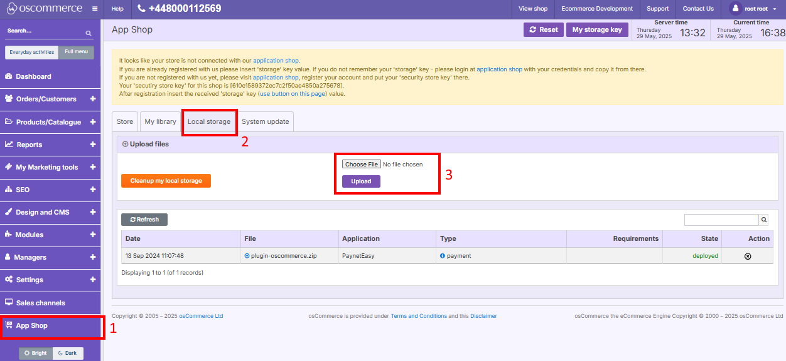
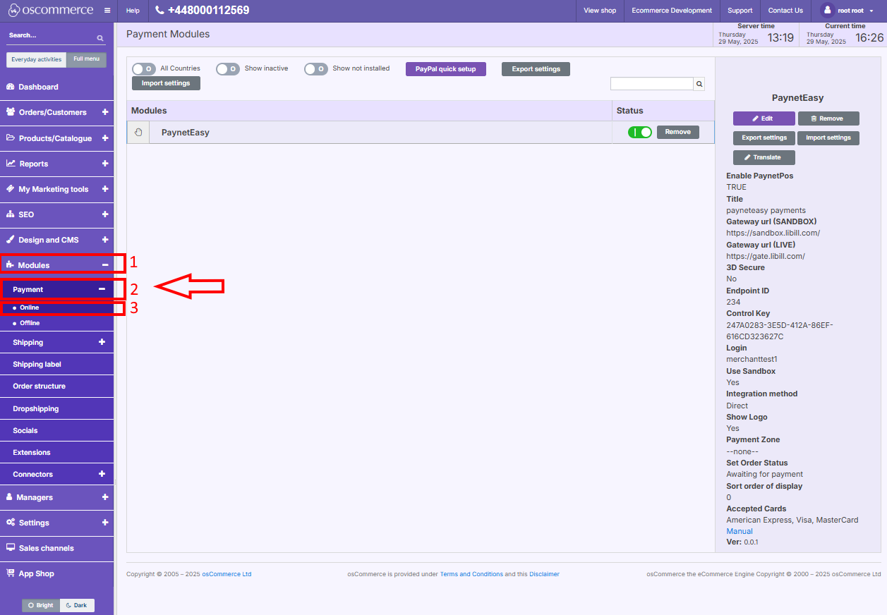
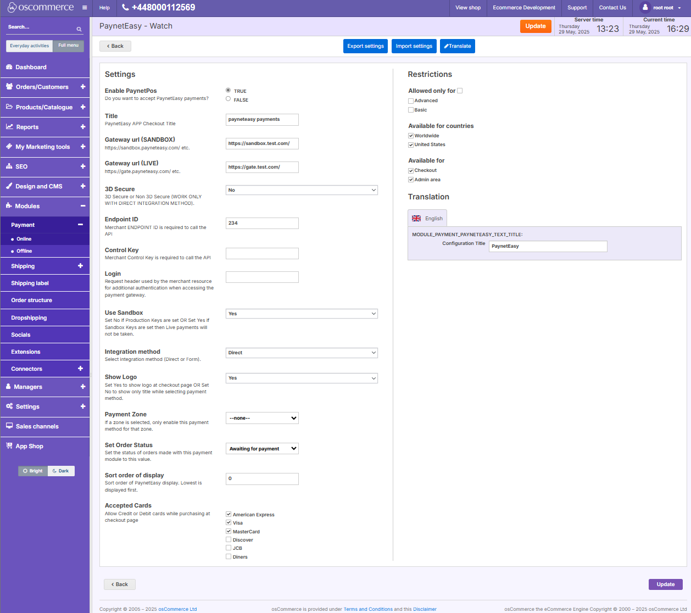
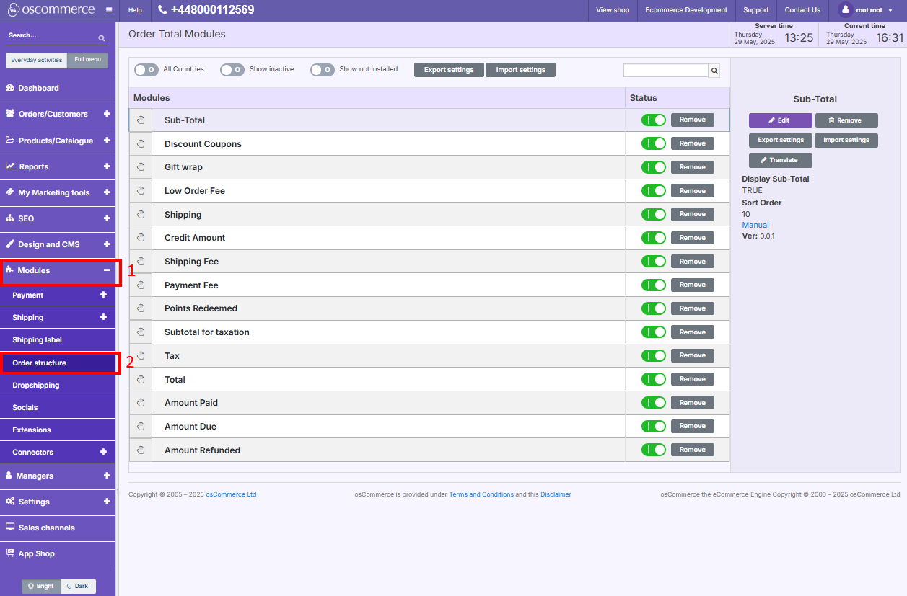
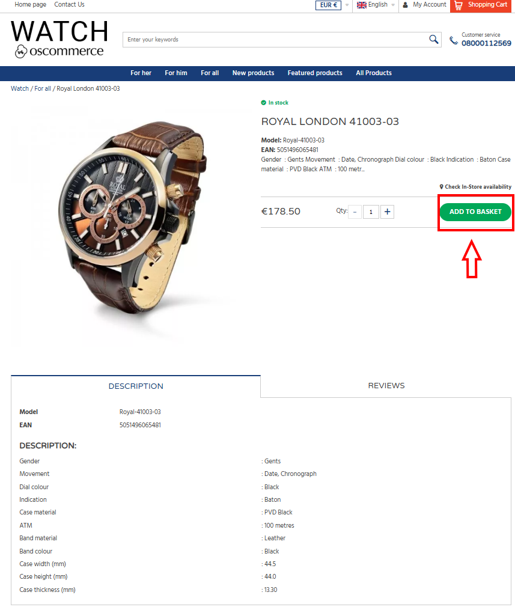
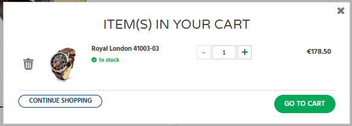
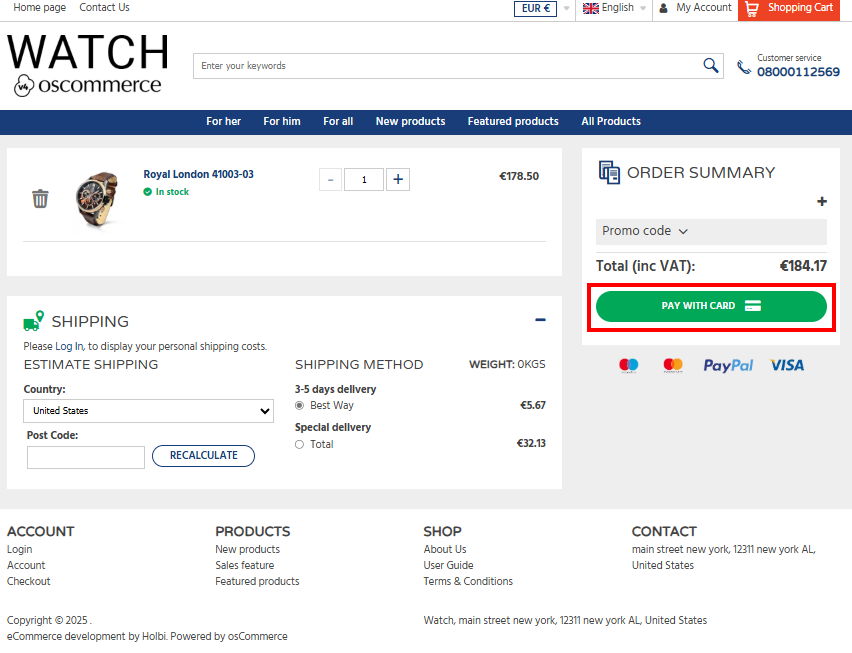
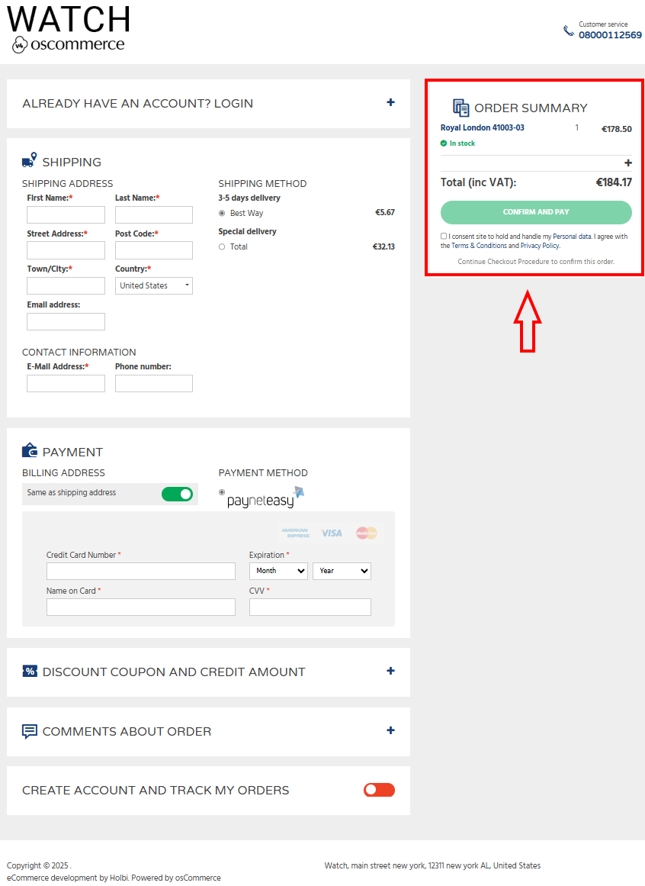
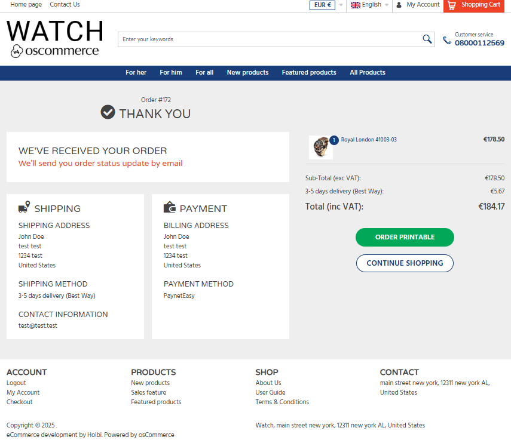

# PaynetEasy Payment Plugin for OsCommerce 4

# 1. [Requirements](https://github.com/annihilatoratm/oscommerce-doc/blob/main/documentation/doc-eng.md#1-requirements-1)
# 2. [Plugin Installation](https://github.com/annihilatoratm/oscommerce-doc/blob/main/documentation/doc-eng.md#2-plugin-installation-1)
# 3. [Plugin Configuration](https://github.com/annihilatoratm/oscommerce-doc/blob/main/documentation/doc-eng.md#3-plugin-configuration-1)
# 4. [Surcharge Fee Module](https://github.com/annihilatoratm/oscommerce-doc/blob/main/documentation/doc-eng.md#4-surcharge-fee-module-1)
# 5. [Payment Flow](https://github.com/annihilatoratm/oscommerce-doc/blob/main/documentation/doc-eng.md#5-payment-flow-1)

## 1. Requirements
Installation, configuration and Payment Flow are tested on:
* OsCommerce version: 4.
* PHP Versions: 7.0.0 or higher.

Note: this module has been tested only with OsCommerce v4+.

## 2. Plugin Installation

2.1. Installation via Admin Panel  
2.1.1. Download the Plugin. Download the plugin-oscommerce.zip file from the designated GitHub repository.  
2.1.2. Upload the Plugin to the System. Navigate to App Shop (1) → Local storage (2), then upload the plugin-oscommerce.zip (3) file.  
2.1.3. Install the Plugin. In the list of available plugins, click the "+" icon in the Action column to install the module.   

2.2. Manual Plugin Installation  
2.2.1. Unpack the ZIP Archive. Extract the contents of the plugin-oscommerce.zip file.  
2.2.2. Upload Plugin Files. Navigate to your project directory: lib\common\modules\orderPayment. Upload the extracted contents from the plugin-oscommerce folder into this directory.  
2.2.3. Manually Move Files. If the installer does not automatically place the following files, move them manually:    
  * Move ot_payneteasy.php from lib\common\modules\orderPayment to lib\common\modules\orderTotal.
  * Move StoredCards.php from lib\common\modules\orderPayment to lib\frontend\design\boxes\account.
  * Move stored-cards.tpl from lib\common\modules\orderPayment to lib\frontend\themes\basic\boxes\account.

## 3. Plugin Configuration
3.1. Access the Admin Panel. Log in to the Admin Panel, then navigate to: Modules (1) -> Payment (2) -> Online (3).  
3.2. Verify Plugin Visibility. Ensure the **PaynetEasy** payment module is visible in the list of available payment methods.  
  * Use the Show not installed filter if it’s not installed yet.  
  * Use the Show inactive filter if the module is inactive.  
    
3.3. Edit Plugin Settings. Click on the **PaynetEasy** payment method entry, then select the _Edit_ (4) button in the right-hand panel to open the configuration settings.  
3.4. Configure the Plugin.  
  * Set Enable **PaynetPos** to **Yes**.
  * Enter the correct credentials.
  * Select your preferred payment method.
  * Configure any additional settings as needed.
  * Click _Update_ to save changes.

  
  
  
## 4. Surcharge Fee Module
  
4.1. Navigate to the Order Structure Modules. In the Admin Panel, go to:  
  * Modules (1) -> Order structure (2)
    
4.2. Verify Module Availability. Locate the **SurchargeFee** module in the list. If it is not yet installed, install it from the available modules list.   
4.3. Configure the Module. Click on the SurchargeFee module, then click the Edit button in the right-hand panel to access the configuration settings.    
4.4. Enable and Configure Settings. Set Display Surcharge Fee to _Yes_, Sort Order and click _Update_.  
  * Set Display Surcharge Fee to Yes.
  * Set the Sort Order value according to your preference.
  * Click _Update_ to save the configuration.
     
4.5. Adjust Module Order. Drag and drop the SurchargeFee module above the Total module. This ensures that the surcharge fee, if enabled, is calculated before the grand total.  

  

# 5. Payment Flow

5.1. Select a Product. Browse the main menu and choose the desired product.

  
5.2. Add to Basket. Click the Add to Basket button to add the selected product to your shopping cart.  
A pop-up message will appear with two options:  
  *  **Continue Shopping** – to keep browsing the store.
  *  **Go to Cart** – to proceed to checkout.

5.3. Proceed to Payment. If you selected Go to Cart, click the Pay with Card button to initiate the payment process.

  
5.4. Complete the Payment Form.    
  * Enter all required information in the payment form.
  * Confirm acceptance of the **Terms & Policies**.
  * Click **Confirm and Pay** to complete the transaction.

